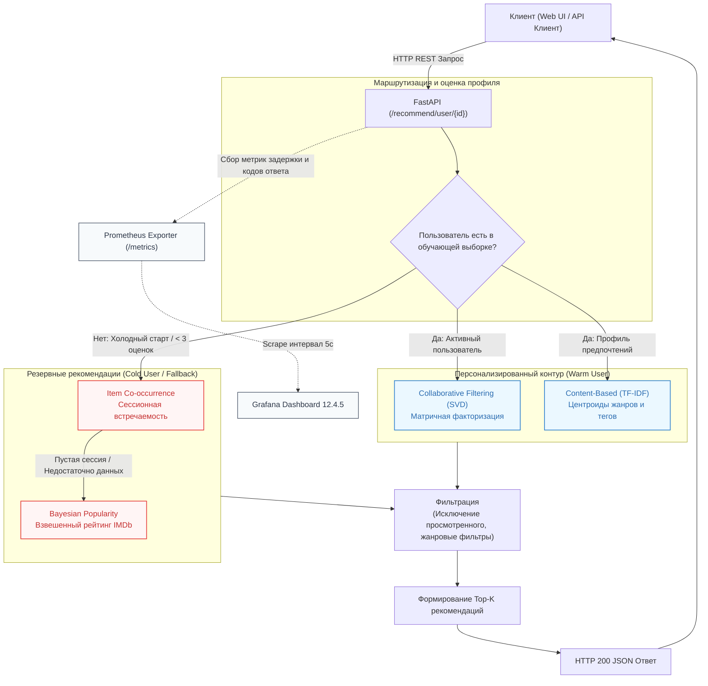

# Рекомендательная система медиа-контента (RecSys Demo)

Проект для сравнения рекомендательных алгоритмов на датасете MovieLens: SVD, TF-IDF, байесовская популярность и совместная встречаемость фильмов. Веб-интерфейс и API позволяют посмотреть рекомендации, а Prometheus и Grafana — познакомиться с мониторингом запросов.

---

## 1. Архитектура системы

Пользователь выбирает модель рекомендаций. Если она возвращает недостаточно фильмов, список дополняется совместной встречаемостью и популярными фильмами. Это демонстрирует обработку холодного старта. Скорость работы зависит от окружения; нагрузочные гарантии в проекте не устанавливаются:



### Реализованные подходы к рекомендациям:

1. **Эвристика 1: Байесовская популярность (IMDb Weighted Rating)**
   - Формула регуляризованного взвешенного рейтинга, учитывающая как среднюю оценку фильма, так и доверительный порог количества голосов.
   - Базовый подход для новых пользователей, у которых ещё нет истории оценок.

2. **Эвристика 2: Встречаемость элементов (Item Co-occurrence, «С этим также смотрят»)**
   - Косинусно-нормализованная матрица совместной встречаемости фильмов в положительных сессиях пользователей ($r \ge 3.5$).
   - Быстрый поиск ассоциаций «фильм-к-фильму» и сессионное ранжирование недавних просмотров.

3. **Классический ML 1: Контентная фильтрация (TF-IDF + Косинусная близость)**
   - Векторизация текстового описания (жанры, очищенные названия, пользовательские теги).
   - Профиль пользователя строится как центроид векторов с весами выставленных рейтингов.

4. **Классический ML 2: Коллаборативная фильтрация (Матричная факторизация SVD)**
   - Усеченное сингулярное разложение (Truncated SVD) центрированной разреженной матрицы оценок (User-Item).
   - Скалярное произведение скрытых латентных факторов пользователей и фильмов для ранжирования фильмов по предпочтениям пользователя.

5. **Гибридный координатор (Hybrid Fallback Pipeline)**
   - Вызывает выбранную модель и дополняет выдачу резервными рекомендациями. Поддерживает исключение просмотренного и отбор по жанру.

---

## 2. Результаты бенчмарка (Top-10)

Оценка моделей выполнена на тестовой выборке с временным разделением (Temporal Holdout: последние 20% взаимодействий каждого пользователя вынесены в тест):

| Модель | Precision@10 | Recall@10 | MAP@10 | NDCG@10 | Catalog Coverage | Novelty (бит) |
|---|---|---|---|---|---|---|
| **PopularityRecommender** | 0.0650 | 0.0474 | 0.0384 | 0.0799 | 0.70% | 8.78 |
| **CooccurrenceRecommender** | 0.0684 | 0.0675 | 0.0427 | 0.0889 | 12.88% | 10.19 |
| **ContentBasedRecommender** | 0.0082 | 0.0085 | 0.0043 | 0.0109 | 19.58% | 14.47 |
| **CollaborativeRecommender** | 0.0811 | 0.0574 | 0.0484 | 0.0986 | 5.15% | 9.35 |

**Основные выводы**:
- Коллаборативная фильтрация (**SVD**) обеспечивает наивысшую точность ранжирования ($NDCG@10 = 0.0986$, $Precision@10 = 0.0811$).
- Контентный подход (**TF-IDF**) обеспечивает максимальное покрытие каталога ($19.58%$) и наивысшую новизну ($14.47$ бит), рекомендуя редкие нишевые фильмы.
- Эвристика совместной встречаемости (**Co-occurrence**) выступает эффективным мостом между точностью и разнообразием, превосходя базовую популярность.

---

## 3. Быстрый старт

### Требования к окружению
- Python 3.10+
- Пакетный менеджер `uv` (или стандартный `pip`)
- Docker и Docker Compose (для запуска в контейнерах)

### Локальный запуск

```bash
# 1. Создание виртуального окружения и установка зависимостей
make install

# 2. Обучение всех моделей и расчет офлайн-метрик
make train

# 3. Запуск автоматических тестов
make test

# 4. Запуск локального веб-сервера
make run
```

Документация Swagger OpenAPI будет доступна по адресу: `http://localhost:8000/docs`

---

## 4. Спецификация API и интерфейсы

- `GET /` — Интерактивная витрина RecSys Demo (веб-интерфейс для демонстрации персональных рекомендаций, холодного старта и поиска похожих фильмов).
- `GET /docs` — Интерактивная документация Swagger OpenAPI.
- `GET /health` — Проверка состояния API и доступности моделей.
- `GET /recommend/user/{user_id}` — Персонализированные рекомендации (параметры: `model_type`, `top_k`, `exclude_seen`, `filter_genre`).
- `GET /recommend/item/{item_id}` — Поиск похожих фильмов (Item-to-Item рекомендации).
- `GET /recommend/popular` — Рекомендации на основе байесовской популярности.
- `GET /metrics` — Экспорт метрик производительности для Prometheus.

---

## 5. Развертывание в Docker и мониторинг

Docker Compose запускает стенд: API на FastAPI с веб-интерфейсом, Prometheus для сбора метрик и Grafana для их просмотра.

Запуск из чистого клона: `docker compose up --build -d`. Локальные каталоги
`data/` и `artifacts/`, а также предварительное обучение не требуются.
При первом запуске API скачивает MovieLens и обучает модели внутри контейнера;
до завершения обучения API недоступен. Нужен доступ к сети для сборки и загрузки
датасета. Прогресс: `docker compose logs -f api`.
Модели сохраняются в файловой системе контейнера: при обычном перезапуске
используются повторно, после удаления или пересоздания контейнера обучаются заново.

```bash
# Сборка образов и фоновый запуск контейнеров
make docker-up

# Остановка контейнеров
make docker-down
```

### Доступные панели и сервисы:
- Веб-витрина Demo UI: `http://localhost:8000`
- Документация Swagger: `http://localhost:8000/docs`
- Интерфейс Prometheus: `http://localhost:9090`
- Дашборд Grafana: `http://localhost:3000` (Авторизация: `admin` / `admin`)
  - Источник данных: автоматически настроенный `Prometheus`.
  - Дашборд: `RecSys Service Dashboard` (мониторинг RPS, квантилей задержки P50/P95/P99, счетчика Fallback-срабатываний и распределения используемых моделей).

---

## 6. Контроль качества кода и CI

- Статический анализ: `make lint` (`ruff check .`)
- Модульные и интеграционные тесты: `make test` (`pytest -v`)
- Автоматизированный пайплайн CI настроен в `.github/workflows/ci.yml`.
